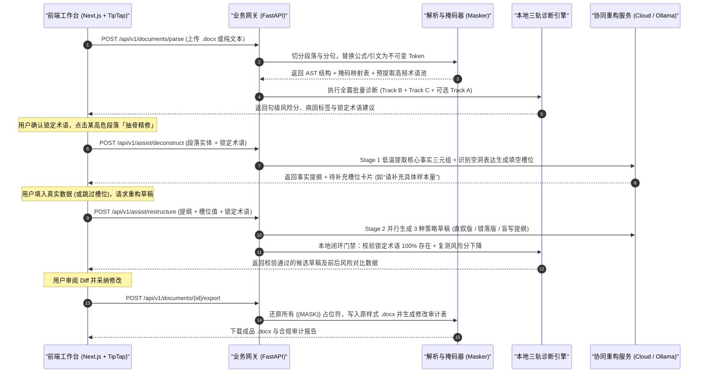
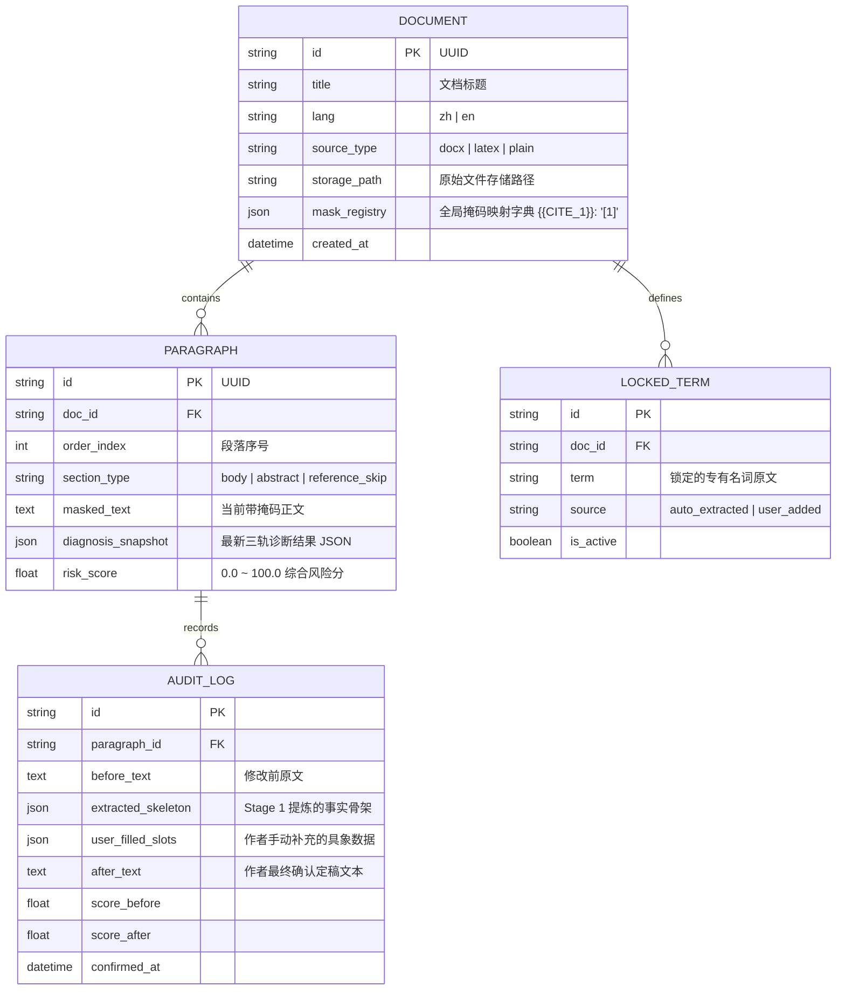

# 学术文本白盒诊断与人机协同精修系统 — 技术开发文档 (TDD)

**文档版本**：`v1.0.0`  
**适用范围**：前后端工程搭建、NLP 诊断引擎研发、大模型协同管线对接与测试验收

> [!NOTE]
> 本文档面向实际编码落地编写，默认采用**「中英双语兼容 + CPU/GPU 弹性降级 + 云端/本地大模型可插拔」**的松耦合设计：在无 GPU 环境下可仅开启“句法 + 词库”双轨秒级运行（MVP 模式）；挂载 GPU 后通过环境变量一键开启本地小模型概率曲率计算（完整三轨模式）。

---

## 1. 工程设计原则与全局数据流

1. **非正文绝对隔离**：公式、引文角标（如 `[12]`、`(Smith et al., 2024)`）、图表标题与参考文献列表在进入任何统计或生成模块前，必须替换为不可变占位符 `{{MASK_TYPE_ID}}`。
2. **诊断与生成解耦**：本地诊断引擎纯静态/本地模型运行，零外部 Token 消耗，且同时作为生成管线的**后置门禁（Quality Gate）**。
3. **术语硬约束与零幻觉**：学科专有名词采用后置代码级字符串校验（非单纯依赖 Prompt）；凡涉及缺失的数据、指标或案例，一律输出结构化填空槽位（Slot），严禁模型捏造事实。



---

## 2. 仓库目录结构规范 (Monorepo)

建议采用如下标准目录结构初始化仓库：

```text
scholar-refine/
├── docker-compose.yml
├── .env.example                     # 全局环境变量模板
├── dictionaries/                    # 静态规则与词库资源 (支持热加载)
│   ├── zh/
│   │   ├── ai_connectors.txt        # 高频显性连接词与套话词组
│   │   ├── hat_boot_patterns.json   # 段首帽句/段尾升华句正则规则
│   │   ├── abstract_fluff.txt       # 低信息密度抽象词表 (赋能、多维、协同等)
│   │   └── academic_stopwords.txt
│   └── en/
│       ├── ai_connectors.txt        # delve into, pivotal, moreover 等
│       ├── hat_boot_patterns.json
│       └── abstract_fluff.txt
├── backend/                         # Python 3.11+ FastAPI 服务端
│   ├── pyproject.toml
│   └── app/
│       ├── main.py                  # FastAPI 入口与生命周期管理 (预加载词机与模型)
│       ├── config.py                # Pydantic Settings 配置管理
│       ├── models/                  # SQLAlchemy ORM 表模型
│       ├── schemas/                 # Pydantic 请求/响应与内部契约 Schema
│       │   ├── document.py
│       │   ├── diagnosis.py
│       │   └── assist.py
│       ├── services/
│       │   ├── parser/
│       │   │   ├── docx_adapter.py  # Word XML 解析与样式保留回写
│       │   │   ├── splitter.py      # 中英文学术分句器 (避免在 et al. / Fig. 1 处误切)
│       │   │   └── masker.py        # 公式/引文双向无损掩码器
│       │   ├── diagnostics/
│       │   │   ├── engine.py        # 三轨调度与加权评分聚合器
│       │   │   ├── track_a_prob.py  # 本地量化小模型 PPL 与条件概率曲率 (可选开启)
│       │   │   ├── track_b_syntactic.py # 句长变异系数 CV 与依存骨架同构度
│       │   │   └── track_c_lexicon.py   # Aho-Corasick 自动机与空洞度比值
│       │   ├── guardrails/
│       │   │   └── term_guard.py    # C-Value 术语预提取 + 后置硬锁定校验器
│       │   └── llm/
│       │       ├── client.py        # 统一适配 OpenAI 兼容接口 / 本地 Ollama / vLLM
│       │       ├── prompts.py       # Stage 1 & Stage 2 结构化提示词模板
│       │       └── pipeline.py      # 抽骨、重构与本地闭环复测重试逻辑
│       └── api/v1/                  # 路由层 (documents, diagnose, assist, export)
└── frontend/                        # Next.js 14+ (App Router) + TypeScript
    ├── package.json
    └── src/
        ├── components/
        │   ├── editor/
        │   │   ├── ScholarEditor.tsx          # TipTap 核心编辑器容器
        │   │   ├── extensions/
        │   │   │   ├── RiskHighlightPlugin.ts # ProseMirror 多色风险下划线装饰器
        │   │   │   └── LockedTermMark.ts      # 锁定术语只读/高亮胶囊扩展
        │   ├── sidebar-left/
        │   │   ├── RiskRadarOverview.tsx      # 章节风险分布导航
        │   │   └── TermWhitelistPanel.tsx     # 术语白名单增删管理
        │   └── sidebar-right/
        │       ├── DiagnosisCard.tsx          # 病因详情标签卡
        │       ├── SlotFillForm.tsx           # 缺失具象信息填空表单
        │       └── DraftDiffViewer.tsx        # 候选方案行内 Diff 与一键替换
        └── stores/
            └── useWorkbenchStore.ts           # Zustand 全局文档与诊断状态树
```

---

## 3. 核心数据契约与存储设计

### 3.1 数据库 ER 设计

MVP 阶段可使用 `SQLite`（桌面端/单机部署），SaaS 生产环境切换为 `PostgreSQL`。



### 3.2 核心内部 Pydantic 数据结构 (`backend/app/schemas/diagnosis.py`)

```python
from enum import Enum
from pydantic import BaseModel, Field

class IssueType(str, Enum):
    AI_CONNECTOR = "ai_connector"           # 高频显性连接词/套话
    HAT_BOOT_CLICHE = "hat_boot_cliche"     # 段首宏大帽句 / 段尾升华套话
    LOW_INFO_DENSITY = "low_info_density"   # 抽象词堆砌、缺乏具体数据锚点
    UNIFORM_LENGTH = "uniform_length"       # 句长高度均质 (低 Burstiness)
    SYNTACTIC_PARALLEL = "syntactic_parallel" # 相邻句法骨架高度同构/排比
    HIGH_PROB_CURVATURE = "high_curvature"  # 语言模型条件概率曲率过高 (过于顺滑)

class TextSpanIssue(BaseModel):
    issue_type: IssueType
    start_char: int                         # 相对于段落文本的起始偏移
    end_char: int                           # 相对于段落文本的结束偏移
    matched_text: str
    message: str                            # 面向用户的白盒解释文案

class SentenceMetric(BaseModel):
    sent_index: int
    text: str
    clean_char_len: int                     # 剔除掩码 Token 后的真实字/词数
    ppl: float | None = None                # 轨道 A：困惑度 (未开启时为 None)
    curvature: float | None = None          # 轨道 A：条件概率曲率 d(x)
    dep_skeleton: str                       # 轨道 B：顶层依存句法签名 (如 "ADV-SBV-VOB")
    fluff_ratio: float                      # 轨道 C：抽象虚词占比
    sentence_risk: float = Field(ge=0, le=100)

class ParagraphDiagnosis(BaseModel):
    paragraph_id: str
    burstiness_cv: float                    # 段落句长变异系数 (sigma / mu)
    overall_risk: float = Field(ge=0, le=100)
    risk_level: str                         # "low" (<35) | "medium" (35-65) | "high" (>65)
    sentences: list[SentenceMetric]
    span_issues: list[TextSpanIssue]
```

---

## 4. 核心算法与模块参考实现

### 4.1 非正文双向掩码器 (`masker.py`)

必须在分词、计算句长、计算 PPL 和调用大模型之前执行，避免公式或文献标号被破坏。

```python
import re
from dataclasses import dataclass, field

@dataclass
class MaskRegistry:
    mapping: dict[str, str] = field(default_factory=dict)
    counter: int = 0

    def register(self, kind: str, raw: str) -> str:
        self.counter += 1
        token = f"{{{{{kind}_{self.counter}}}}}"
        self.mapping[token] = raw
        return token

# 按优先级从长到短匹配：行间公式 -> 行内公式 -> 方括号文献引述 -> 著者年份引述 -> URL/DOI
MASK_PATTERNS: list[tuple[str, re.Pattern]] = [
    ("MATH", re.compile(r"\$\$[\s\S]+?\$\$|\\\[[\s\S]+?\\\]")),
    ("MATH", re.compile(r"\$[^$\n]+\$|\\\([^\n]+?\\\)")),
    ("LATEX_CMD", re.compile(r"\\(?:cite|ref|eqref|label)\{[^}]+\}")),
    ("CITE", re.compile(r"\[\s*\d+(?:\s*[-–,，]\s*\d+)*\s*\]")),
    ("CITE", re.compile(r"\([A-Z][A-Za-z\s.&]+(?:et al\.)?,?\s*\d{4}[a-z]?\)")),
]

def mask_academic_text(text: str, registry: MaskRegistry) -> str:
    masked = text
    for kind, pattern in MASK_PATTERNS:
        masked = pattern.sub(lambda m: registry.register(kind, m.group(0)), masked)
    return masked

def unmask_academic_text(masked_text: str, registry: MaskRegistry) -> str:
    restored = masked_text
    # 按键名逆序还原，防止前缀包含冲突
    for token, raw in sorted(registry.mapping.items(), key=lambda x: len(x[0]), reverse=True):
        restored = restored.replace(token, raw)
    return restored
```

---

### 4.2 本地三轨诊断核心计算逻辑 (`diagnostics/`)

#### (1) 轨道 B：句长突发性与句法骨架同构度 (`track_b_syntactic.py`)

```python
import numpy as np
from difflib import SequenceMatcher

MASK_TOKEN_RE = re.compile(r"\{\{[A-Z_]+_\d+\}\}")

def effective_length(sent: str, lang: str = "zh") -> int:
    """剔除掩码占位符与标点后的有效长度"""
    cleaned = MASK_TOKEN_RE.sub("", sent).strip()
    if lang == "en":
        return len(cleaned.split())
    return len(re.sub(r"[^\w\u4e00-\u9fff]", "", cleaned))

def compute_burstiness_cv(sentences: list[str], lang: str = "zh") -> float:
    """计算段落句长变异系数 CV = std / mean。人类通常 > 0.30，典型 AI 常 < 0.18"""
    if len(sentences) < 3:
        return 0.5  # 短段落不做低波动惩罚
    lengths = np.array([max(1, effective_length(s, lang)) for s in sentences], dtype=float)
    return float(np.std(lengths) / np.mean(lengths))

def detect_syntactic_parallelism(dep_skeletons: list[str], threshold: float = 0.78) -> list[int]:
    """
    输入每句顶层依存关系序列（如由 HanLP/spaCy 提取的 'ADV-SBV-PREP-VOB-COO'），
    返回与前一句结构高度雷同的句子下标列表。
    """
    parallel_indices = []
    for i in range(1, len(dep_skeletons)):
        if not dep_skeletons[i] or not dep_skeletons[i - 1]:
            continue
        sim = SequenceMatcher(None, dep_skeletons[i - 1], dep_skeletons[i]).ratio()
        if sim >= threshold:
            parallel_indices.extend([i - 1, i])
    return sorted(set(parallel_indices))
```

#### (2) 轨道 C：Aho-Corasick 套话扫描与空洞度计算 (`track_c_lexicon.py`)

* **具象锚点（Concrete Anchors）定义**：句中包含阿拉伯数字、百分比、`{{CITE_*}}`、`{{MATH_*}}`、比较级数值表达（如 `提升了 4.2%`、`p < 0.05`、`n = 120`）。
* **空洞度判定公式**：
  $$\text{FluffScore}(s) = \frac{\text{Count}(\text{AbstractWords})}{1 + 2 \times \text{Count}(\text{ConcreteAnchors})}$$
  当单句包含 $\ge 2$ 个抽象宏大词（如“多维、赋能、协同、显著提升、长效机制”）且 `ConcreteAnchors == 0` 时，直接触发 `LOW_INFO_DENSITY` 标签，为后续 Stage 1 自动生成数据填空槽位提供依据。

#### (3) 轨道 A（可选 GPU/ONNX 增强）：条件概率曲率 (`track_a_prob.py`)

借鉴 `Fast-DetectGPT` 的零样本检测原理，无需训练分类器，仅需一次前向传播拿到 `logits` 即可在几毫秒内完成：

```python
import torch
import torch.nn.functional as F

@torch.no_grad()
def compute_prob_curvature(input_ids: torch.Tensor, logits: torch.Tensor, n_samples: int = 50) -> float:
    """
    input_ids: [1, seq_len]
    logits:    [1, seq_len, vocab_size] (由本地 Qwen2.5-1.5B 或 GPT-2 输出)
    返回条件概率曲率 d(x)：值越高，说明每个词越贴近大模型最高概率采样分布
    """
    # 对齐预测位与真实目标词位
    shift_logits = logits[0, :-1, :]                       # [T-1, V]
    shift_labels = input_ids[0, 1:]                        # [T-1]
    if shift_labels.numel() < 5:
        return 0.0

    log_probs = F.log_softmax(shift_logits, dim=-1)        # [T-1, V]
    probs = torch.exp(log_probs)

    # 1. 真实文本的对数似然和
    observed_ll = log_probs.gather(-1, shift_labels.unsqueeze(-1)).squeeze(-1).sum()

    # 2. 在同一条件分布下采样替代词的对数似然期望与方差（解析解，甚至无需显式采样）
    expected_token_ll = (probs * log_probs).sum(dim=-1)    # E[log p(x)]
    expected_ll = expected_token_ll.sum()

    variance_token_ll = (probs * (log_probs ** 2)).sum(dim=-1) - (expected_token_ll ** 2)
    std_ll = torch.sqrt(torch.clamp(variance_token_ll.sum(), min=1e-6))

    curvature = (observed_ll - expected_ll) / std_ll
    return float(curvature.item())
```

> [!TIP]
> 上述代码使用了期望与方差的**精确解析解**（无需随机采样循环），单句在 `Qwen2.5-1.5B (INT8 ONNX)` 上推理仅需一次 Forward Pass，CPU 耗时约 40～90ms，入门级 GPU 耗时 $< 8\text{ ms}$。

#### (4) 综合风险分聚合公式 (`engine.py`)

* **完整三轨模式（开启本地小模型）**：
  $$\text{Risk} = 0.35 \cdot S_{\text{curvature}} + 0.30 \cdot S_{\text{syntactic}} + 0.35 \cdot S_{\text{lexicon}}$$
* **轻量双轨模式（纯 CPU 无模型模式）**：
  $$\text{Risk} = 0.45 \cdot S_{\text{syntactic}} + 0.55 \cdot S_{\text{lexicon}}$$
  （其中各项子分数均通过分段线性函数归一化至 $[0, 100]$ 区间）。

---

### 4.3 专业术语预提取与后置硬校验门禁 (`term_guard.py`)

```python
from collections import Counter

def validate_locked_terms_preserved(
    original_masked: str,
    candidate_masked: str,
    locked_terms: list[str],
    mask_tokens_in_orig: list[str],
) -> tuple[bool, list[str]]:
    """
    确定性硬门禁：
    1. 原段中出现的所有锁定专业术语，在候选草稿中必须至少保留存在（不允许被同义替换）；
    2. 原段中所有的公式与文献掩码 Token（如 {{CITE_1}}）必须 100% 原样保留。
    """
    missing: list[str] = []

    # 校验不可变掩码 Token 频次一致
    orig_mask_counts = Counter(t for t in mask_tokens_in_orig if t in original_masked)
    for token, cnt in orig_mask_counts.items():
        if candidate_masked.count(token) < cnt:
            missing.append(f"遗漏引文或公式标记: {token}")

    # 校验在原段中实际出现过的锁定术语是否完好保留
    for term in locked_terms:
        if term in original_masked and term not in candidate_masked:
            missing.append(f"核心术语被改动或丢失: {term}")

    return (len(missing) == 0, missing)
```

---

### 4.4 双阶段协同重构 Prompt 与 JSON Schema (`llm/prompts.py`)

#### Stage 1：语义抽骨与槽位提取（`Temperature = 0.1`，开启 JSON Schema 结构化输出）

* **System Prompt 规范**：
  ```text
  你是一名严谨的学术编辑助手。请将用户提供的学术段落剥离所有修辞套话、背景帽句、总结升华句与显性连接词（如“值得注意的是、综上所述、此外”），仅提炼核心事实与逻辑链条。
  严格遵守以下规则：
  1. 原样保留所有形如 {{CITE_1}}、{{MATH_1}} 的占位符及【锁定术语列表】中的专有名词。
  2. 严禁编造任何原文不存在的数据、指标或文献结论。
  3. 识别原文中表意空泛、缺乏具象支撑的表述（如“显著提升、复杂场景、具有重要意义”），将其转化为面向人类作者提问的填空槽位（slots）。
  ```
* **输出 JSON Schema**：
  ```json
  {
    "removable_hat_or_boot": ["识别出可直接删减的段首空泛铺垫句或段尾升华套话"],
    "core_propositions": [
      "原子事实论点 1（保留 {{CITE_*}} 与锁定术语）",
      "原子事实论点 2"
    ],
    "slots": [
      {
        "slot_id": "slot_1",
        "vague_phrase": "原文中的空泛词（如：显著缓解了过拟合）",
        "prompt_for_author": "建议补充：具体在哪个数据集或何种参数条件下？验证指标具体下降/提升了多少？（若暂无数据可留空跳过）",
        "placeholder_example": "例如：在 CIFAR-100 长尾子集上 Top-1 误差降低 2.4%"
      }
    ]
  }
  ```

#### Stage 2：差异化句式重构 + 本地闭环门禁（`pipeline.py`）

将 Stage 1 的 `core_propositions` + 用户填写的 `slot_values` 组装后请求生成 3 种模式：
1. **`direct_concise`（砍帽直叙版）**：删除 `removable_hat_or_boot`，禁用禁用词表中的所有显性连接词（通过传入 `banned_phrases` 清单约束），靠主语指代与因果关系直接连句。
2. **`asymmetric_rhythm`（长短错落版）**：强制打破均长句，要求段落内至少包含一句 $\le 16$ 字的紧凑判断短句，避免“通过…实现了…”等对称介词句式。
3. **`blind_write_card`（盲写提纲卡）**：不输出完整段落，仅输出箭头逻辑链（如 `痛点：传统方法受限于 X -> 本文引入 [锁定词] -> 实验结果：[用户补充数据]`），供作者在编辑器内自主复述定稿。

**闭环重试机制（最多重试 1 次）**：
生成后立即在后台调用 `validate_locked_terms_preserved()` 与 `diagnose_paragraph()`。若发现某草稿误删了锁定术语或残余禁用连接词，将具体缺失项拼入错误反馈自动触发一次修正；仍未通过则在前端置灰并提示原因。

---

## 5. 前后端 RESTful API 核心接口契约

统一响应信封格式：`{ "code": 0, "message": "ok", "data": { ... } }`。

| 接口路径 | 方法 | 核心职责与入参摘要 | 核心返回字段摘要 |
| :--- | :--- | :--- | :--- |
| `/api/v1/documents/parse` | `POST` | `Multipart/form-data` 上传 `.docx` 或传 JSON `{ title, raw_text, lang }` | `{ doc_id, paragraphs[], suggested_terms[], global_risk_summary }` |
| `/api/v1/documents/{doc_id}/terms` | `PUT` | `{ terms: ["多头自注意力", "RMSE", ...] }` 更新本文锁定术语池 | `{ active_term_count, updated_at }` |
| `/api/v1/diagnose/paragraph` | `POST` | `{ doc_id, paragraph_id, current_text }` 编辑器实时防抖（Debounce 800ms）单段重算 | `ParagraphDiagnosis` 对象（毫秒级返回最新下划线坐标与分数） |
| `/api/v1/assist/deconstruct` | `POST` | `{ doc_id, paragraph_id }` 触发 Stage 1 语义抽骨与槽位生成 | `{ removable_hat_or_boot[], core_propositions[], slots[] }` |
| `/api/v1/assist/restructure` | `POST` | `{ doc_id, paragraph_id, propositions[], filled_slots: { slot_1: "..." } }` 触发 Stage 2 生成与本地门禁复测 | `{ candidates: [{ mode, text, new_risk_score, burstiness_cv, term_check_passed }] }` |
| `/api/v1/documents/{doc_id}/export` | `POST` | `{ include_audit_report: true }` 还原掩码并导出文档 | 返回 `.zip` 流（内含无损排版的成品 `.docx` 与 Markdown/PDF 格式《修改合规审计日志》） |

---

## 6. 前端富文本工作台实现要点 (`TipTap` / `ProseMirror`)

> [!WARNING]
> **前端实现避坑**：切勿将诊断出的风险高亮（红黄下划线）写成富文本本身的 `Mark` 存入文档 JSON，否则撤销栈（Undo/Redo）与文档导出会被严重污染。必须使用 ProseMirror 的 **`Decoration.inline`（视图装饰层）**实现。

### 无侵入多色风险下划线插件 (`RiskHighlightPlugin.ts`)

```typescript
import { Extension } from "@tiptap/core";
import { Plugin, PluginKey } from "@tiptap/pm/state";
import { Decoration, DecorationSet } from "@tiptap/pm/view";

export interface SpanDecorationMeta {
  from: number; // ProseMirror 文档绝对位置
  to: number;
  issueType: "ai_connector" | "hat_boot_cliche" | "low_info_density" | "syntactic_parallel";
  tooltip: string;
}

export const riskPluginKey = new PluginKey<DecorationSet>("riskHighlights");

const CLASS_MAP: Record<SpanDecorationMeta["issueType"], string> = {
  ai_connector: "underline decoration-purple-500 decoration-wavy decoration-2 bg-purple-50/40",
  hat_boot_cliche: "underline decoration-red-500 decoration-2 bg-red-50/50",
  low_info_density: "underline decoration-amber-500 decoration-dashed decoration-2",
  syntactic_parallel: "bg-yellow-100/60 border-b border-yellow-500",
};

export const RiskHighlightExtension = Extension.create({
  name: "riskHighlight",
  addProseMirrorPlugins() {
    return [
      new Plugin({
        key: riskPluginKey,
        state: {
          init: () => DecorationSet.empty,
          apply(tr, oldSet) {
            const nextSpans: SpanDecorationMeta[] | undefined = tr.getMeta(riskPluginKey);
            if (nextSpans) {
              const decos = nextSpans.map((s) =>
                Decoration.inline(s.from, s.to, {
                  class: CLASS_MAP[s.issueType],
                  "data-issue-tooltip": s.tooltip,
                })
              );
              return DecorationSet.create(tr.doc, decos);
            }
            // 用户正常打字编辑时，自动映射偏移量，保持其余段落高亮不错位
            return oldSet.map(tr.mapping, tr.doc);
          },
        },
        props: {
          decorations(state) {
            return this.getState(state);
          },
        },
      }),
    ];
  },
});
```

---

## 7. 环境配置、开发里程碑与验收标准

### 7.1 环境变量配置模板 (`.env.example`)

```ini
# 运行模式：dual_track (纯CPU轻量模式) | tri_track (开启本地小模型曲率计算)
DIAG_ENGINE_MODE=dual_track
LOCAL_PROB_MODEL_PATH=./models/qwen2.5-1.5b-onnx-int8
DEVICE=cpu

# 协同重构大模型配置 (支持云端 OpenAI 兼容接口或本地私有化 Ollama/vLLM，保障未发表论文隐私)
LLM_BASE_URL=http://localhost:11434/v1
LLM_API_KEY=ollama
LLM_MODEL_NAME=qwen2.5:14b-instruct

# 存储配置
DATABASE_URL=sqlite+aiosqlite:///./data/scholar_refine.db
```

### 7.2 研发推进里程碑 (Checklist)

* **M1 — 核心内核与静态体检闭环（第 1 周）**
  * [ ] 完成中英文学术分句器 `splitter.py`（正确跳过 `Fig. 1`、`et al.`、`e.g.`、`3.14` 等小数点与缩写）与双向掩码器 `masker.py` 单元测试。
  * [ ] 整理首批中英文高频 AI 套话词典（各 150+ 条）、首尾帽句正则（30+ 条）与抽象空泛词表。
  * [ ] 跑通轨道 B（句长 `CV` + 依存骨架相似度）与轨道 C（Aho-Corasick + 空洞度）后端单测。
* **M2 — 术语锁与双阶段重构管线（第 2 周）**
  * [ ] 实现 `C-Value` / 高频名词短语预提取与 `validate_locked_terms_preserved` 硬校验门禁。
  * [ ] 调通 Stage 1（抽骨与槽位生成）与 Stage 2（三策略草稿 + 本地诊断复测）API 接口。
* **M3 — 前端三栏工作台联调（第 3 周）**
  * [ ] 基于 `TipTap` 完成多色风险下划线装饰器、段落编辑 800ms 防抖实时重算、右侧槽位填写与行内 Diff 替换交互。
* **M4 — Word 无损排版与概率引擎升级（第 4 周）**
  * [ ] 完成 `python-docx` 段落级 XML 文本替换（保留原文档各级标题字号、行距、内嵌图片、公式对象与尾注）及合规审计日志导出。
  * [ ] 接入 `ONNX Runtime` 量化 `1.5B` 模型，开启轨道 A 条件概率曲率计算，并用测试集校准融合权重。

### 7.3 工程质量验收指标

1. **非正文无损率**：包含 20+ 公式与 50+ 文献角标的 `.docx` 导入、修改并导出后，公式与引文标号完整一致率必须达到 **100%**。
2. **锁定术语零误伤**：加入白名单的学科专有名词在所有推送给前端的推荐草稿中保留率 **100%**。
3. **诊断响应延迟**：10,000 字论文全篇静态诊断（双轨 CPU）耗时 **$< 500\text{ ms}$**；单段编辑实时重算耗时 **$< 60\text{ ms}$**；开启轨道 A 本地 `1.5B` 模型后全篇诊断耗时 **$< 3\text{ s}$**（GPU）或 **$< 12\text{ s}$**（8 核 CPU）。
4. **零捏造合规性**：对不含实验数据的纯泛化测试段落运行 50 次抽骨重构，模型自行编造具体数值或虚假文献引用的次数必须为 **0**（100% 转化为 `slots` 提示用户填写）。
